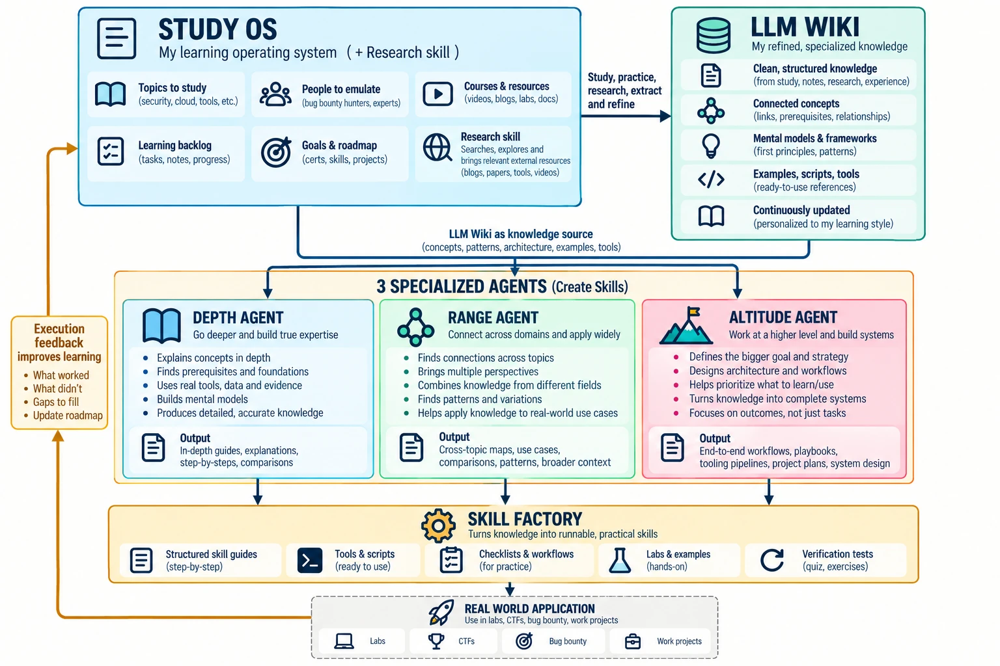

# Study-Skill-Builder

**A learning operating system for AI agents.** Four study phases, three specialized agents (depth, range, altitude), a private LLM wiki, and a skill factory that turns what you learn into runnable skills. Built for security study (web pentest, cloud, AI security), but it works for any field.

This repo is the **skeleton**: phases, skills, hooks, rules, and the agents. Your knowledge stays on your machine. The LLM wiki, the skills the factory builds, and every study artifact are private by design and never live here.



## The loop

```text
Study-OS (phases 1-4 + research)  --study, practice, research, extract-->  LLM wiki (private)
LLM wiki                          --knowledge source-->                     depth | range | altitude agents
the three agents                  --skill candidates-->                     skill factory
skill factory                     --runnable skills (private)-->            labs, CTFs, bug bounty, work
real-world use                    --execution feedback-->                   backlog and roadmap --> Study-OS
```

## What is inside

| part | where | does |
|---|---|---|
| Phase 1: map | `skills/phase_1/` | interview the learner, freeze the context, map the parts, dependencies and stuck points |
| Phase 2: page | `skills/phase_2/` | one study page from the map, first principles first, then a judge in its own window, then diagrams, an interactive page, an explainer video |
| Phase 3: test | `skills/phase_3/` | Socratic spar, academic papers, a practical build |
| Phase 4: diagnose | `skills/phase_4/` | find the shared root of repeated misses, route back to the right phase |
| Three agents | `.agents/` | `depth_agent`, `range_agent`, `altitude_agent` |
| LLM wiki skills | `skills/wiki/` | `SCHEMA.md` plus `wiki_ingest`, `wiki_query`, `wiki_lint` |
| Obsidian skills | `skills/obsidian/` | vendored from kepano/obsidian-skills (MIT): wiki page syntax, bases, canvas, CLI, clean web capture |
| Skill factory | `skills/skill_factory/skill_smith/` | turns agent output into a guide, scripts, a checklist, a lab and a verification test |
| House skills | `skills/misc/` | `skill_creator`, `karpathy_agents_md`, `learn_from_sessions` |
| Hooks | `.github/hooks/`, `.grok/hooks/`, `skills/scripts/hooks/` | log every prompt, tool call and deliverable per session, with secrets redacted |
| Rules | `.rules/` | grounding and confidence grades, brevity, HTML deliverables, context isolation, phase order, skill authoring, visuals |
| Map | `REPO_MAP.md` | where everything is. regenerate with `python skills/scripts/repo_map.py` |

## The three agents

From Felix Rieseberg's four directions of ambition (speed, altitude, depth, range). Speed is a given, so each of the other three is an agent.

- **Depth agent.** Works as a field-leading expert would: raw data, real tools, first principles, an outside check. It asks for "a deeper version of this task, not a bigger one". Output: in-depth guides, prerequisites, mental models, comparisons.
- **Range agent.** Turns nouns into verbs to find which fields apply. Brings a small crew of perspectives plus a red team, each as its own subagent. Output: cross-topic maps, use cases, patterns, variants.
- **Altitude agent.** Works at the level of outcomes: the goal beyond the goal, the urgent decisions, a workflow redesign that runs with little input. Output: workflows, playbooks, pipelines, project plans, the roadmap.

Shared rules: each agent runs in its own context window, no agent grades its own work, and every agent does the work of a role instead of role-playing it.

## The private layers

| layer | folder (created locally, never committed here) | built by |
|---|---|---|
| LLM wiki | `llm_wiki/` with `raw/`, `wiki/{concepts,connections,mental_models,examples,sources}/`, `index.md`, `log.md` | `wiki_ingest` creates it on first run. open it in Obsidian as a vault |
| Built skills | `skill_factory/inbox/`, `skill_factory/built/`, `skill_factory/feedback.md` | the three agents and `skill_smith` |
| Study output | `Artifacts/` | the phases and the hooks |
| Your sources | `user-input-learning-text/` | you. read only |

`.gitignore` blocks all four. Keep your filled-in copy in a private repo.

## Quick start

1. Clone the repo. Open it with Claude Code, Codex, Copilot or any agent that reads `AGENTS.md`.
2. Read `AGENTS.md`, then `REPO_MAP.md`.
3. Copy the agents where your tool loads them, for example for Claude Code:

   ```bash
   mkdir -p .claude/agents && cp .agents/*_agent.md .claude/agents/
   ```

4. Study a topic: run phase 1 on a book chapter, a course or a case, then phase 2.
5. File the result in your wiki: `/wiki_ingest`.
6. Go deeper, wider or higher with the three agents. Turn their candidates into skills with `/skill_smith`.
7. Use the skills in labs, CTFs, bug bounty or work. Log what worked in `skill_factory/feedback.md`. Phase 4 and the altitude agent read it back into the roadmap.

## Keep your fork private-safe

If you keep a private full copy and publish only the skeleton, use the export script. It copies an allowlist, scrubs, rebuilds the map, then scans for private matches (emails, home paths, key patterns, and any term you list in a local `.export_private.json`). It exits 1 on any match.

```bash
python skills/scripts/export_public.py ../my-public-skeleton
```

## References and inspirations

People and work this system is built on:

- **Felix Rieseberg**: "How to be more ambitious: a tutorial for humans with models". The altitude, depth and range agents. https://felixrieseberg.com/how-to-be-more-ambitious-a-tutorial-for-humans-with-models/
- **Andrej Karpathy**: the "LLM Wiki" pattern (raw sources, wiki, schema; ingest, query, lint). https://gist.github.com/karpathy/442a6bf555914893e9891c11519de94f
- **Andrej Karpathy**: coding-agent guidelines (think first, simplicity, surgical changes, goal-driven), via https://github.com/multica-ai/andrej-karpathy-skills, and the idea of diagrams, interactive pages and explainer videos as learning aids.
- **Steph Ango (kepano)**: obsidian-skills, vendored in `skills/obsidian/` (MIT). https://github.com/kepano/obsidian-skills
- **Anthropic**: skill-creator, adapted in `skills/misc/skill_creator/` (Apache 2.0). https://github.com/anthropics/skills/tree/main/skills/skill-creator
- **Agent Skills specification**: https://agentskills.io/specification. **Claude Code skills docs**: https://code.claude.com/docs/en/skills
- **Nick Saraev**: the study method behind the phases. His talk suggests about ten agents for learning, which this system splits across the four phases (map, learn, exam, feedback). https://youtu.be/FSXHk4hMrY8
- **Andrej Karpathy**: the writing style, prose edited at the level of its structure like an AST, not line by line. https://x.com/karpathy/status/2105819303471976479
- **3Blue1Brown and the manim community**: the explainer video style. https://docs.manim.community
- **Diagram tools**: diagram-design (https://github.com/cathrynlavery/diagram-design), anatomy (https://github.com/wheresryan22/anatomy), archify (https://github.com/tt-a1i/archify).
- **ASD-STE100 Simplified Technical English**: the plain writing rule. https://www.asd-ste100.org/
- **Geoffrey Huntley**: the Ralph loop technique, used to build this repo. https://ghuntley.com/ralph/
- In Felix Rieseberg's post: Tom Kelley and Jonathan Littman (nouns to verbs), Locke and Latham (hard, specific goals).

## The story, and thanks to failure

This took a long time and a lot of failure. From late February through October I tried to build a study system that would teach me and get it right, and it kept not working. That struggle is the reason it now iterates: it turns what I learn into skills and improves itself. I hope it helps all of us pick up new skills fast, or at least in a reasonable time, in the age of AI.

## Licenses

Third-party parts keep their own licenses: `skills/obsidian/LICENSE` (MIT, Steph Ango) and `skills/misc/skill_creator/LICENSE.txt` (Apache 2.0, Anthropic). No license is set yet for the rest of the repo.

---

Built by [@mccleod1290](https://github.com/mccleod1290).
