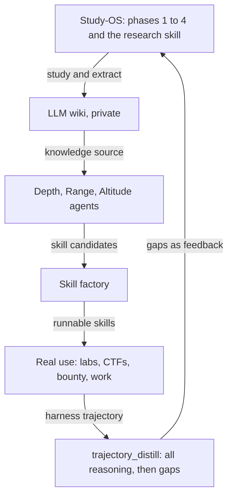
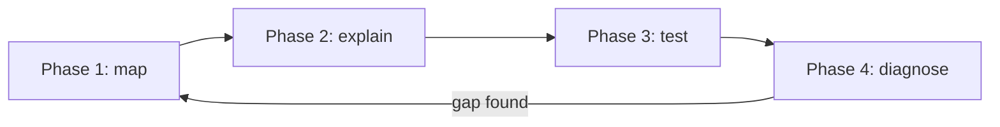
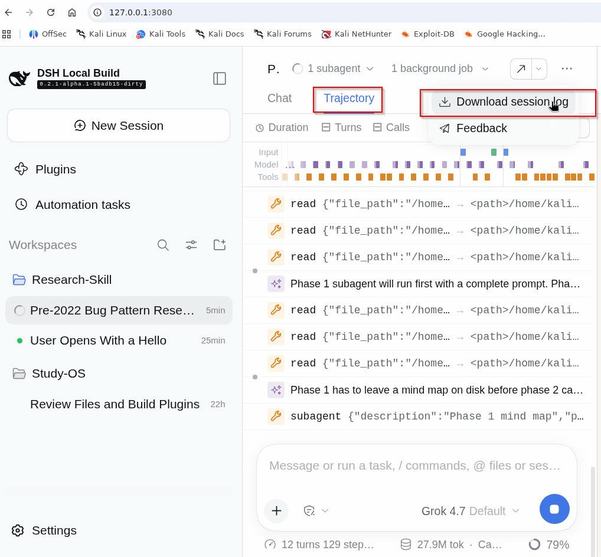
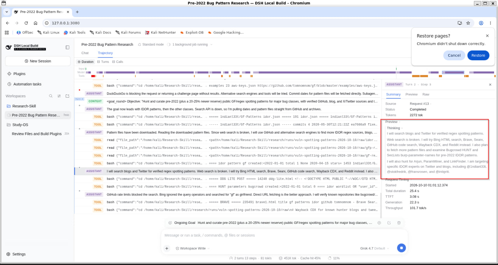
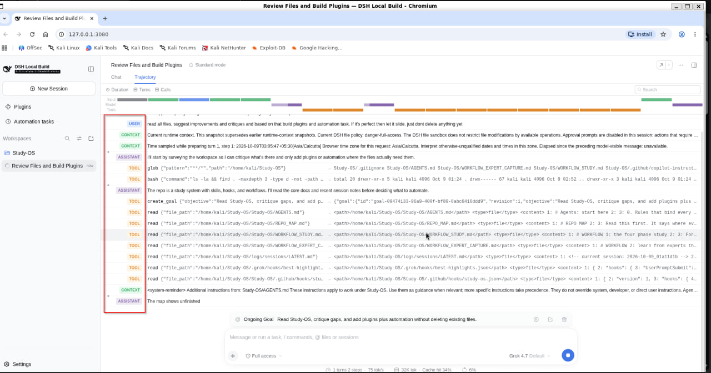

# Study-Skill-Builder

**A learning operating system for people and AI agents. It stops passive learning.**

Most study is passive. You watch a video. You read a page. You copy a solution. You feel that you learned. You did not. You remember that you saw it. You cannot do it when it counts. Exposure is not skill.

This system makes you do the opposite. A person runs it by hand. An agent runs it for you. The steps are the same. You map the topic. You explain it from first principles. You take a test until a gap has a name. You build the real thing on a real target. You find what you missed, and you close it. The way to beat passive learning is one way, for a person and for an agent.

Inside are four study phases, a research skill, three agents (depth, range, altitude), a private wiki, and a skill factory. It was built for security study: web pentest, cloud, and AI security. It works for any field.

This repository is the skeleton. It holds the phases, the skills, the rules, the agents, and the self-improving loop. Your knowledge stays on your machine. The wiki, the built skills, and every study artifact are private. They never live here.


## The loop



The loop closes on the harness trajectory. The runtime is the [DeepSeek Harness](https://github.com/deepseek-ai/deepseek-harness). It records each run: the model's reasoning and every tool call. `trajectory_distill` reads the export. It writes one file of all the reasoning. It writes a second file of the reasoning and tool use that the skill did not cover. It mails both. It files the gaps as feedback. The skills improve from real runs, not from guesses.

## Passive in, active out

Each phase removes one passive habit. It puts an active move in its place. The move is the same for a person and for an agent.

| passive habit | active move | phase |
|---|---|---|
| watch a video, read a chapter | map the parts, the dependencies, and the stuck points | phase 1 |
| highlight and re-read | explain from first principles; cite and grade each claim | phase 2 |
| nod along, feel sure | take a Socratic spar and an exam until a gap has a name | phase 3 |
| copy the solution | build it on a real lab, CTF, bounty, or work target | the real use |
| move on and forget | find the shared root of repeated misses, then loop back | phase 4 |



A lab solved by copying the walkthrough is logged as `exposure`, not `solved`. This one rule is the whole method. The system does not let you fool yourself.

## The illusion of competence

The illusion of competence is real. This system breaks it. It is easy to think you understood a thing from exposure alone. Everyone has seen a ZIP file. Few can explain how the compression works. To see a thing is not to understand it.

> "You can outsource your thinking, but you can't outsource your understanding."

That line is [kache's (@yacineMTB)](https://x.com/yacineMTB). [Andrej Karpathy](https://x.com/karpathy) cites it often. It is the reason this system exists. You can give the thinking to an agent, a video, or a walkthrough. You cannot give away the understanding. The why, the mechanics, and the failure modes stay with you. So the system never lets the final answer stand for the understanding. It makes you explain the mechanics, take a test, and build the thing. These are the parts you cannot outsource.

## What is inside

| part | where | what it does |
|---|---|---|
| Phase 1: map | `skills/phase_1/` | interviews the learner, freezes the context, maps the parts, the dependencies, and the stuck points |
| Phase 2: explain | `skills/phase_2/` | writes one study page from the map. first principles first. then a judge, diagrams, an interactive page, and a video |
| Phase 3: test | `skills/phase_3/` | runs a Socratic spar, three papers, and a practical build |
| Phase 4: diagnose | `skills/phase_4/` | finds the shared root of repeated misses, then routes back to the right phase |
| Research skill | `research-skill/` (submodule) | searches and brings in outside resources that feed the wiki. lives in [mccleod1290/Research-Skill](https://github.com/mccleod1290/Research-Skill) |
| Three agents | `.agents/` | `depth_agent`, `range_agent`, `altitude_agent` |
| LLM wiki skills | `skills/wiki/` | `SCHEMA.md`, `wiki_ingest`, `wiki_query`, `wiki_lint` |
| Obsidian skills | `skills/obsidian/` | vendored from kepano/obsidian-skills (MIT): page syntax, bases, canvas, CLI, clean web capture |
| Skill factory | `skills/skill_factory/skill_smith/` | turns agent output into a guide, scripts, a checklist, a lab, and a test |
| Self-improving loop | `skills/self_improve/trajectory_distill/` | reads a trajectory export, writes two HTML files, mails them, files gaps |
| House skills | `skills/misc/` | `skill_creator`, `karpathy_agents_md`, `learn_from_sessions` |
| Rules | `.rules/` | grounding, brevity, HTML output, context isolation, phase order, skill authoring, visuals |
| Map | `REPO_MAP.md` | where everything lives. rebuild it with `python skills/scripts/repo_map.py` |

## The three agents

The source is Felix Rieseberg's four directions of ambition: speed, altitude, depth, and range. Speed is a given. Each of the other three is an agent.

- **Depth agent.** It works as a field expert works: raw data, real tools, first principles, and an outside check. It asks for a deeper version of a task, not a bigger one. It writes guides, prerequisites, mental models, and comparisons.
- **Range agent.** It turns the nouns into verbs to find which fields apply. It brings a small crew of views and a red team. Each view is its own subagent. It writes cross-topic maps, use cases, patterns, and variants.
- **Altitude agent.** It works at the level of outcomes: the goal behind the goal, the urgent decisions, and a workflow that runs with little input. It writes workflows, playbooks, pipelines, and plans.

Three rules bind all of them. Each agent runs in its own context window. No agent grades its own work. Each agent does the work of a role. It does not play the role.

## The private layers

These layers hold your knowledge. The `.gitignore` blocks all of them. Keep your filled copy in a private repository.

| layer | folder (local only, never committed here) | built by |
|---|---|---|
| LLM wiki | `llm_wiki/` with `raw/`, `wiki/`, `index.md`, `log.md` | `wiki_ingest` makes it on first run. open it in Obsidian |
| Built skills | `skill_factory/inbox/`, `skill_factory/built/`, `skill_factory/feedback.md` | the three agents and `skill_smith` |
| Study output | `Artifacts/` | the phases |
| Your sources | `user-input-learning-text/` | you. read only |

## Quick start

1. Clone with submodules. The research skill is a submodule. Run `git clone --recursive <url>`. After a plain clone, run `git submodule update --init`. Open the folder with Claude Code, Codex, the DeepSeek Harness, or any agent that reads `AGENTS.md`. You can also run the phases by hand. A person and an agent follow the same steps.
2. Read `AGENTS.md`, then `REPO_MAP.md`.
3. Load the agents. For Claude Code:

   ```bash
   mkdir -p .claude/agents && cp .agents/*_agent.md .claude/agents/
   ```

4. Study a topic. Run phase 1 on a chapter, a course, or a case. Then run phase 2.
5. File the result in your wiki with `/wiki_ingest`.
6. Go deeper, wider, or higher with the three agents. Turn their candidates into skills with `/skill_smith`.
7. Use the skills in labs, CTFs, bounty, or work.
8. Close the loop. Export the run from the harness Trajectory tab with "Download session log". Run `/trajectory_distill`. It writes the two HTML files, mails them, and files the gaps to `skill_factory/feedback.md`. Phase 4 and the altitude agent read the gaps back into the roadmap.

## Memory

There are three levels of memory. They go from raw to refined.

| level | what it is | source |
|---|---|---|
| Trajectory | one run: the reasoning and every tool call | the [DeepSeek Harness](https://github.com/deepseek-ai/deepseek-harness). it feeds `trajectory_distill` |
| Runtime recall | memory across sessions, optional | [claude-mem](https://github.com/thedotmack/claude-mem). use it where your client supports it |
| Curated knowledge | the refined, linked wiki | `llm_wiki/`, private. this one compounds |

The old session hooks are gone. A hook never saw the reasoning. The trajectory does. So the trajectory replaced the hooks.

### Email

The self-improvement pass can mail the two HTML files. The script reads your SMTP settings from a local file outside the repository. Put a Gmail app password in `~/.config/study-os/smtp.env`. Do not put it in the code, the repository, or a chat. The steps are in `skills/self_improve/trajectory_distill/references/email-setup.md`.

## Tips and tricks: get the most from what you learn

This is not a secret. Take it and use it. These habits turn knowledge into skill, for a person and for an agent.

**1. Run the self-improvement pass on every real session.** Export the trajectory from the harness. Use the Trajectory tab, then "Download session log". Distill it. The first file holds all the reasoning. The second file holds the reasoning and tool use that your skill never taught. The second file is your next lesson.



**2. Read your own reasoning, not the answer.** The trajectory shows how you thought. It shows the dead ends and the turns, for example "web search is broken, try Bing instead". The skill lives in those turns. The clean final answer does not hold it. Exposure cannot give you this.



**3. Save the tool order as a checklist.** The order of the reads and the commands is the method. Lift it out of the trajectory. Make it a skill with a lab and a test. Next time you run the method, not your memory of it.



**4. Turn a repeated gap into a skill, not a note.** A gap that shows up twice is a missing skill. Send it to the factory. The factory writes the guide, the script, the checklist, the lab, and the test. A skill you cannot run is still exposure.

**5. Grade yourself without mercy.** Mark each result `exposure` or `solved`. If you needed the walkthrough, it is `exposure`. Write `exposure`. Come back to it.

**6. Feed the wiki. Link every page.** Each run gives new concepts and distilled gaps. Put them in `llm_wiki/` with wikilinks. The knowledge then compounds. It does not scatter across old chats.

**7. Ask for depth, not size.** When you return to a topic, ask for a deeper version of the task, not a bigger one. Ask for the raw data, the real tools, and the first principles. This is the depth agent's job.

**8. Set it all up with one prompt.** Do not configure it by hand. Open the repository in an agent. Tell it in plain words to set itself up. For example:

> Read `AGENTS.md` and `REPO_MAP.md`. Copy the agents into `.claude/agents/`. Initialise the `research-skill` submodule. Make the `llm_wiki/` vault from `skills/wiki/SCHEMA.md`. Walk me through the email file. Then confirm `python twin/check.py` prints OK.

The agent does the wiring. This burns tokens. It saves your time. That is the trade the system is built on. You spend cheap model tokens. You keep your hours for learning and building, not for setup and notes.

### Setup, by prompt or by hand

Let an agent do step 8, or do it yourself.

1. Clone with submodules. Run `git clone --recursive <this-repo>`. After a plain clone, run `git submodule update --init`.
2. Pick a runtime. Read its install docs.
   - DeepSeek Harness, the runtime behind the loop: https://github.com/deepseek-ai/deepseek-harness
   - Claude Code, skills and agents: https://code.claude.com/docs/en/skills. The Agent Skills spec: https://agentskills.io/specification
3. Load the agents. Run `mkdir -p .claude/agents && cp .agents/*_agent.md .claude/agents/`.
4. Add memory, optional. claude-mem: https://github.com/thedotmack/claude-mem. The Obsidian skills come from https://github.com/kepano/obsidian-skills.
5. Set up email, optional. Follow `skills/self_improve/trajectory_distill/references/email-setup.md`.
6. The research skill lives in its own repository: https://github.com/mccleod1290/Research-Skill.

Check each project's own README for the current steps.

## Keep your fork private-safe

You keep a private full copy. You publish only the skeleton. Use the export script. It copies an allowlist. It scrubs. It rebuilds the map. It scans for private strings: emails, home paths, key patterns, and any term in a local `.export_private.json`. It exits with an error on any match.

```bash
python skills/scripts/export_public.py ../my-public-skeleton
```

## References and inspirations

People and work this system is built on:

- **Felix Rieseberg.** "How to be more ambitious: a tutorial for humans with models." The source of the altitude, depth, and range agents. https://felixrieseberg.com/how-to-be-more-ambitious-a-tutorial-for-humans-with-models/
- **Andrej Karpathy.** The LLM wiki pattern: raw sources, wiki, schema; ingest, query, lint. https://gist.github.com/karpathy/442a6bf555914893e9891c11519de94f
- **Andrej Karpathy.** Coding-agent guidelines: think first, keep it simple, make surgical changes, drive by the goal. Via https://github.com/multica-ai/andrej-karpathy-skills. Also the use of diagrams, interactive pages, and explainer videos to learn.
- **Andrej Karpathy.** The writing style: edit prose at the level of its structure, like an AST, not line by line. https://x.com/karpathy/status/2105819303471976479
- **kache (@yacineMTB), cited by Andrej Karpathy.** "You can outsource your thinking, but not your understanding." The line behind the whole system. https://x.com/yacineMTB
- **Steph Ango (kepano).** obsidian-skills, vendored in `skills/obsidian/` (MIT). https://github.com/kepano/obsidian-skills
- **Anthropic.** skill-creator, adapted in `skills/misc/skill_creator/` (Apache 2.0). https://github.com/anthropics/skills/tree/main/skills/skill-creator
- **Agent Skills specification.** https://agentskills.io/specification. Claude Code skills docs: https://code.claude.com/docs/en/skills
- **Nick Saraev.** The study method behind the phases. His talk proposes about ten agents for learning. This system splits them across the four phases: map, learn, exam, feedback. https://youtu.be/FSXHk4hMrY8
- **3Blue1Brown and the manim community.** The explainer video style. https://docs.manim.community
- **Diagram tools.** diagram-design: https://github.com/cathrynlavery/diagram-design. anatomy: https://github.com/wheresryan22/anatomy. archify: https://github.com/tt-a1i/archify
- **ASD-STE100 Simplified Technical English.** The plain writing rule. https://www.asd-ste100.org/
- **DeepSeek Harness (dsh).** The runtime whose trajectory feeds the loop. https://github.com/deepseek-ai/deepseek-harness
- **Alex Newman (@thedotmack).** claude-mem, the runtime memory option. https://github.com/thedotmack/claude-mem
- **Geoffrey Huntley.** The Ralph loop, used to build this repository. https://ghuntley.com/ralph/
- From Felix Rieseberg's post: Tom Kelley and Jonathan Littman (nouns to verbs), and Locke and Latham (hard, specific goals).

## The story, and thanks to failure

This took a long time and a lot of failure. From late February to October I tried to build a study system that would teach me and get it right. It kept not working. The thing I kept hitting was my own passive learning. I watched. I read. I nodded. I still could not do the thing. So I built a system that does not let me stay passive, and that an agent can run by the same rules. That failure is why it now iterates. It turns what I learn into skills. It improves itself. I hope it helps all of us pick up new skills fast, or at least in a fair time, in the age of AI.

## Licenses

Third-party parts keep their own licenses. `skills/obsidian/LICENSE` is MIT, Steph Ango. `skills/misc/skill_creator/LICENSE.txt` is Apache 2.0, Anthropic. The rest of the repository has no license yet.

---

Built by [@mccleod1290](https://github.com/mccleod1290).
