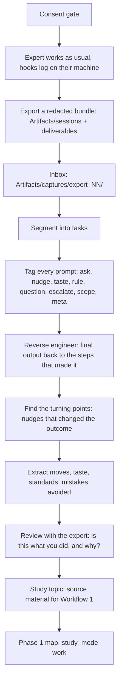

# WORKFLOW 2: learn from experts through their session logs

Goal: take the logs an experienced person leaves while working with the AI, work backwards from their final output, and turn what they did into a study topic for someone else.
This is a way to learn their skill. It is not a way to monitor or rank people.

## Consent gate. Do this first, every time

- The person says yes, in writing, before any logging starts. They know what is logged: prompts, tool calls, files made. They know what is not: their reasoning text, the screen, other apps.
- They choose what is shared. They can read the bundle before it leaves their machine and strike anything out.
- Real names never enter the study files. Use an alias: `expert_01`. The map from alias to person is kept by the person, not here.
- Use is stated: study material for this learner. Not performance review. Not shared outside.
- Secrets are redacted at the source by the hook. A second pass checks before analysis.
- They can withdraw. Then their bundle and everything derived from it is deleted.
- Work data (case ids, account ids, client names) is scrubbed or replaced with placeholders before it becomes study material.

If any item is not true, stop. Do not capture.



## Steps

| step | what happens | reads | writes | status |
|---|---|---|---|---|
| 0 consent | the gate above | | `Artifacts/captures/<alias>/CONSENT.md` | manual |
| 1 capture | hooks log on the expert's machine: `inputs`, `prompts`, `actions`, `deliverables` | their session folders | | built (hooks, not yet confirmed firing in the app) |
| 2 inbox | the expert exports the session folders. alias only | | `Artifacts/captures/<alias>/sessions/` | manual copy |
| 3 segment | cut sessions into tasks: a start prompt to a delivered file | inputs, deliverables | `tasks.md` | to build |
| 4 tag | label each prompt. what did he ask, steer, require | inputs, actions | `tags.md` | method exists in `skills/misc/learn_from_sessions` |
| 5 reverse engineer | start from the final file. walk back: which prompt produced which change, which tool call, which retry | deliverables, actions, `HISTORY.md` | `trace_<task>.md` | to build |
| 6 turning points | the few nudges after which the output got better. what was the nudge, what was wrong before, what did the expert see | trace | `turning_points.md` | to build |
| 7 moves and taste | repeated moves, the quality bar, what they refuse, how they start and finish | tags, trace | `moves.md`, `taste.md` | partly `learn_from_sessions` |
| 8 review with expert | show them the findings. correct anything wrong. their reasons beat our guesses | findings | `reviewed.md` | manual |
| 9 study topic | turn reviewed moves into a topic: skill goals, worked examples, traps | `reviewed.md` | `TARGET.md` for Workflow 1 | to build |
| 10 map, learn, test | run Workflow 1 with `study_mode: work`. phase 3 exam is: do task X the way the expert would, with a trace to compare | | all Workflow 1 files | built |

## What the log can and cannot show

Can: what was asked, in what order, which nudges came after which output, what files were made, how many redo cycles, which tools the AI used.
Cannot: why the expert thought it. The hooks do not carry reasoning text. Step 8 exists for this. Treat step 5 to 7 as hypotheses until the expert confirms.
Outcome quality is not in the log. The expert or the learner has to say which deliverable was good.

## What a lesson looks like

```text
task: audit evidence request for a cloud trust policy
turning point: prompt 7. expert says "show me the condition keys, not the policy summary"
before: AI summarised the policy
after: AI listed the aud and sub conditions and the audit finding became specific
move: ask for the raw field, then ask what is missing
confidence: medium (2 instances), confirmed by expert: yes
```

## Where files go

```text
Artifacts/captures/<alias>/        inbox and analysis for one expert. git-ignored
Artifacts/artifacts/<group>/<topic>/   the study topic made from it. no real names
```

Add `Artifacts/captures/` to `.gitignore` before the first capture.

## What is built and what is not

Built: the hooks (inputs, tool calls, deliverables), the layout, `learn_from_sessions` for one user, `/tidy`, the four phase workflow.
To build, in this order: `expert_capture` skill (steps 3, 5, 6, 9) under `skills/misc/`, the consent template, an export script that bundles and re-redacts a session folder, and `.gitignore` for captures.
