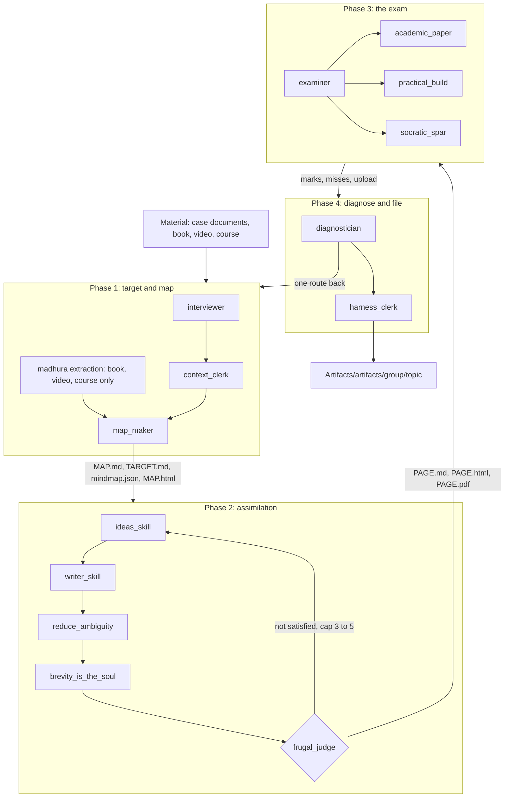

# WORKFLOW 1: the four phase study

For one learner and one topic. Goal: go from knowing nothing to doing the work alone, with proof.
Rules of output: `.rules/artifacts-and-sessions.md`. Where things are: `REPO_MAP.md`.

## Phases

| phase | job | skills | reads | writes (in `Artifacts/artifacts/<group>/<topic>/`) | gate to enter |
|---|---|---|---|---|---|
| 1 target and map | find what he knows, freeze it, map what to learn | `interviewer`, `context_clerk`, `map_maker` (+ `madhura-extraction-system` for book, video, course) | source material, his answers | `phase1_target`, `phase1_context`, `phase1_map`, `phase1_mindmap.json`, `phase1_map.html` | none |
| 2 assimilation | enough depth and breadth to work alone. no quiz | `ideas_skill`, `writer_skill`, `reduce_ambiguity`, `brevity_is_the_soul`, `frugal_judge` | phase 1 map and target | `phase2_page` (.md .html .pdf), `phase2_eval`, `phase2_sources` | phase 1 files exist |
| 3 exam | prove it. practical build, three papers, a live spar | `examiner`, `academic_paper`, `practical_build`, `socratic_spar` | phase 1 map, phase 2 page | the papers, the brief, marks | phase 1 and 2 files exist |
| 4 diagnose and file | find the shared root of his misses, one route back, file everything | `diagnostician`, `harness_clerk` | phases 1 to 3, session logs | `DIAGNOSIS`, topic `INDEX.md` | phase 3 done |

A phase that is missing its input does not start. It stops and says which file is missing.

## Run it

1. Put the source in `user-input-learning-text/<case>/`. Private. Never edited.
2. Phase 1. `/interviewer`, then the map. Run `python skills/scripts/build_mindmap.py <topic_slug>`. Exit 0 and a hash.
3. Learn from the mind map. Pick learn alone or the AI prompt on each topic. Set status: to learn, learning, got it.
4. Phase 2. Start it only after phase 1 is complete: build exit 0 and the phase 1 agent done. Asked for both at once, run phase 1 first and wait (`.rules/phase-order-and-coverage.md`). One page per domain. Start with the domains the map marks audit critical.
5. Phase 3 when the page is clear. Build, write, upload.
6. Phase 4. Take the one route back it gives you. Re-enter at the phase it names.
7. `/tidy`. Then `python skills/scripts/repo_map.py`.
8. About every 7 days: `/learn_from_sessions`. It shows how to use the AI better. `python skills/scripts/learn_due.py` says when.

## Many topics

Related topics (ten AWS topics for one case) share a group folder: `Artifacts/artifacts/aws-saa-course/<topic_slug>/`. `/tidy` files them from `_groups.json`.
Domains are phase 2 pages. One map, many pages, one exam.

## Modes of study

`study_mode` in `mindmap.json`: audit, book, video, course, work. Size and wording follow the mode (`skills/phase_1/skills/map_maker/references/MODES.md`).
Principle: do not copy the pattern point to point. Adapt it to the use case and the study mode.

## Logged for you

The hooks write every prompt, every tool call and every deliverable to `Artifacts/sessions/<YYYY>/<DD-MM>/<HH-MM-SS>_<id>/`. Phase 4 reads them. Compaction does not remove them.
