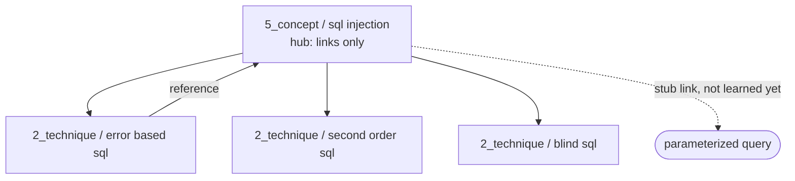
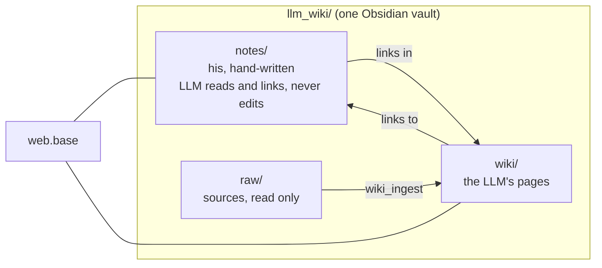
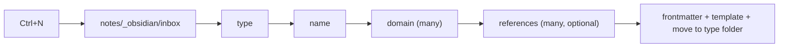
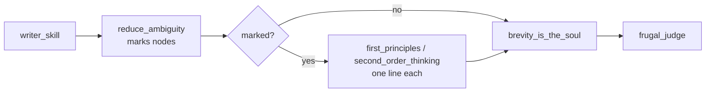

# Notes

Short, linked, searchable notes for security work. Two skills and one test. They live inside the LLM wiki vault, in a folder of their own.

Idea (after [Helton](https://grahamhelton.com/blog/human-memory-management)): the common word is the entry point, the rare words are atomic notes under it. In an engagement you search `sql injection`, not `error based sql`.



## Parts

| part | path | job |
|---|---|---|
| `note_writer` | `note_writer/` | writes or trims one note: flat bullets, common-name title, one schema, links while writing |
| `vault_setup` | `vault_setup/` | builds the vault: folders, templates, Bases, the new-note router plugin, a CSS snippet, seed notes |
| `wiki/` | `wiki/` | the LLM wiki skills, moved here from `skills/wiki/`: `SCHEMA.md`, `wiki_ingest`, `wiki_query`, `wiki_lint` |
| `linked/` | `linked/` | local links to the phase 2 skills notes borrow (below) |
| `check_note.py` | `note_writer/scripts/` | the eval. Fails a note over 120 body words, with missing fields, or in the wrong folder. `--stubs` lists unknown terms |

## One vault: his notes and the LLM wiki

The vault is `llm_wiki/`. Two owner folders, one search, one graph, one `web` view.



One name is one file. A note and a wiki page never share a title. `check_note.py` fails on a collision, and `wiki_ingest` links to the note instead of writing a twin. The router acts only on the inbox, so it never touches a wiki page an agent just wrote.

## One vault, not five

Type sets the folder. `domain` sets the focus. `web.base` shows web notes and web wiki pages together, so web pentest stays one click away.



Cancel at any step: the note stays in the inbox. The inbox and `_obsidian/attachments` are git-ignored.

## Borrowed skills (linked, not copied)

`python skills/notes/link_skills.py` links these into `skills/notes/linked/`. The source stays in `skills/phase_2/skills/`, one copy only. The links are local: git-ignored and never exported.

| linked skill | used in notes for |
|---|---|
| `first_principles` | an ambiguous bullet: law, convention or assumption. One `why:` line |
| `second_order_thinking` | a decision or default where the next event is the lesson. One `next:` line |
| `socratic_questions` | opt-in, live. One question at a time |
| `writer_skill` | his writing style: short declaratives, no hype |
| `brevity_is_the_soul` | explanation stays, fluff goes |
| `diagrammer` | a concept that can be drawn is drawn: an inline SVG in a research note |

Windows needs admin or Developer Mode for a symlink. The script falls back to a directory junction, which needs neither. To remove a link use `rmdir`, never `rm -r`.

## Where the lenses fit

`first_principles` and `second_order_thinking` run only on a bullet that is ambiguous. Each adds one line at most. `socratic_questions` is opt-in and live. The order of a study page is `skills/phase_2/PAGE_ORDER.md`.



## Install

```text
python skills/notes/vault_setup/scripts/install_vault.py llm_wiki --dry-run
python skills/notes/vault_setup/scripts/install_vault.py llm_wiki
node skills/notes/vault_setup/tests/test_router.js
python skills/notes/note_writer/scripts/check_note.py llm_wiki/notes --stubs
```

Then open `llm_wiki/` in Obsidian, turn on community plugins, enable New note router.
