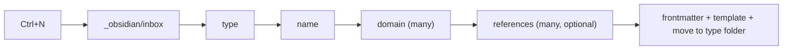
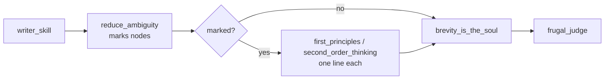

# Notes

Short, linked, searchable notes for security work. Two skills and one test.

Idea (after [Helton](https://grahamhelton.com/blog/human-memory-management)): the common word is the entry point, the rare words are atomic notes under it. In an engagement you search `sql injection`, not `error based sql`.


## Parts

| part | path | job |
|---|---|---|
| `note_writer` | `note_writer/` | writes or trims one note: flat bullets, common-name title, one schema, links while writing |
| `vault_setup` | `vault_setup/` | builds the vault: folders, templates, Bases, the new-note router plugin, a CSS snippet, seed notes |
| `check_note.py` | `note_writer/scripts/` | the eval. Fails a note over 120 body words, with missing fields, or in the wrong folder. `--stubs` lists unknown terms |

## One vault, not five

Type sets the folder. `domain` sets the focus. `web.base` shows web notes only, so web pentest stays one click away.



Cancel at any step: the note stays in the inbox.

## Where the lenses fit

`first_principles` and `second_order_thinking` run only on a bullet that is ambiguous. Each adds one line at most. `socratic_questions` is opt-in and live. The order of a study page is `skills/phase_2/PAGE_ORDER.md`.



## Install

```text
python skills/notes/vault_setup/scripts/install_vault.py <dest> --dry-run
python skills/notes/vault_setup/scripts/install_vault.py <dest>
node skills/notes/vault_setup/tests/test_router.js
python skills/notes/note_writer/scripts/check_note.py <dest> --stubs
```

Then open `<dest>` in Obsidian, turn on community plugins, enable New note router.
